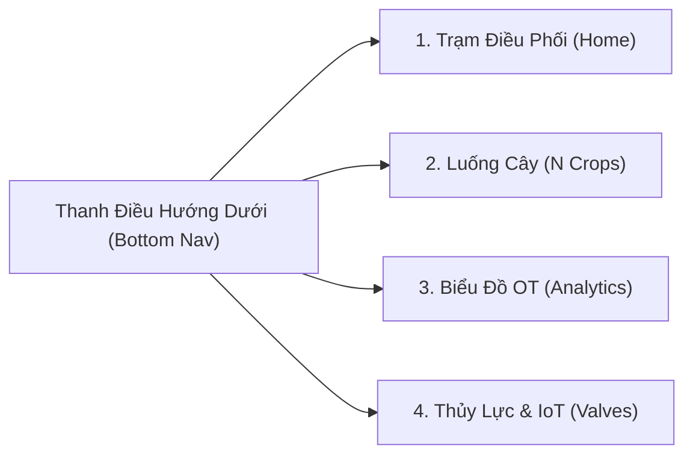

# 03. Đặc Tả Tính Năng & Thiết Kế Giao Diện Mobile (Features & Plantix-Inspired UX/UI Spec)

## 1. Phân loại Tính năng MVP (MoSCoW Prioritization)

### 1.1. Must-Have (Bắt buộc có trong bản MVP đầu tiên)
1. **Quản lý Trang trại $N$ Luống Cây & Thư viện 4 Giai đoạn Sinh trưởng (Plantix Crop Library):**
   * Hiển thị danh sách $N$ luống cây bằng thẻ trực quan (Plantix Crop Cards).
   * Tích hợp **Thư viện Cây trồng chuẩn (Plantix Crop Library)** (Xà lách, Cải ngọt, Cà chua, Dâu tây, Dưa lưới, Ớt chuông, Dưa chuột, Rau muống...) với thông số $(\text{pH}, \text{EC})$ tự động cập nhật theo **4 giai đoạn sinh trưởng**: *1. Cây con (Kiến thiết)*, *2. Sinh trưởng thân lá*, *3. Ra hoa*, *4. Nuôi quả / Thu hoạch*.
   * Hỗ trợ **Chế độ Trọng số Kép**: Mặc định trọng số bằng nhau ($1/N$) hoặc bật tính trọng số theo **Diện tích luống ($\text{m}^2$) & Độ nhạy cảm giống cây ($s_i$)**.
   * Nút nạp nhanh **"Kịch bản Mẫu Sáng chế ($N=2$: Xà lách & Cải ngọt)"** và **"Kịch bản Trang trại Đa canh ($N=6$ loại cây)"** để demo tức thì.
2. **Trạm Điều khiển Chu kỳ Hàng ngày & 4 Khối giờ Sinh học + Vi khí hậu (Interactive Bio-Clock & Simulator):**
   * Hỗ trợ **Chế độ Chu kỳ Hàng ngày (1 lần phối trộn/ngày thay cho $4N$ lần)** đúng theo đề bài `Description of Độ đo tổng thể..docx`, VÀ **Chế độ 4 Khối giờ sinh học ($t=1..4$)** theo bản sáng chế mở rộng (`Tài liệu gửi sinh viên.docx`).
   * Chọn kịch bản thời tiết (Ôn hòa, Nắng gắt bức xạ cao $K_{\text{sunny}}$, Mưa lớn rửa trôi $K_{\text{rainy}}$) và thanh trượt tùy chỉnh hệ số phạt chuyên gia (**Low Penalty** & **High Penalty** cho cả $x$ tránh bó rễ và $y$ tránh cháy rễ).
3. **Bộ giải Độ đo Dinh dưỡng Tổng thể (OT Quantile + Quét không gian Nelder-Mead Simplex):**
   * Cho phép chọn thuật toán giải: **Tâm hình học Vận tải tối ưu (OT Barycenter)** hoặc **Thuật toán tìm cực tiểu Nelder-Mead (hiển thị quỹ đạo quét không gian giải pháp trên mặt phẳng 2D)**.
   * Mặc định tự động phát hiện và chuyển sang **Đa tâm động (Wasserstein K-Means)** khi độ phân hóa vượt ngưỡng (`Auto-Detect`), đồng thời cho phép người dùng bật/tắt thủ công giữa **Đơn tâm (1 lần pha)** và **Đa tâm ($M_t = 2, 3, 4$ cụm)** để so sánh trực tiếp.
   * Hiển thị rõ kết quả $(x^*, y^*)$ (Độ pH & Nồng độ EC tổng thể), tổng chi phí tổn thất sinh học $\mathcal{D}_{\text{bio}}$, cùng **Bảng Thống kê Tiết kiệm 5 Chi phí Điều khiển (Điện, Nước, Dinh dưỡng, Acid, Bazơ)** so với phương pháp pha $4 \times N$ lần và so với các thước đo Euclidean [24], DTW [25], TTW [27].
4. **Định lượng Chuẩn Thủy canh cho 4 Bể A, B, C, D (`103–106`) & 4 Van (`107–110`):**
   * Quy ước chuẩn thủy canh thực tế: **Bể A (`103` - Van `107`)** và **Bể B (`104` - Van `108`)** là dung dịch phân gốc A & B giúp tăng nồng độ EC ($y$); **Bể C (`105` - Van `109`)** là dung dịch Acid ($\text{pH Down}$) hạ độ pH ($x$); **Bể D (`106` - Van `110`)** là dung dịch Bazơ ($\text{pH Up}$) nâng độ pH ($x$).
   * Tự động tính toán và hiển thị lượng dung dịch cần bơm ($\text{mL}$) và thời gian mở van định lượng ($t_{\text{open}}$ giây) cho từng kỳ phối trộn.
5. **Lưu trữ Cục bộ kết hợp Đồng bộ Cloud (Supabase / Firebase) & Màn hình Đăng nhập:**
   * Có màn hình **Đăng nhập / Đăng ký tài khoản trang trại** (kèm nút **Vào nhanh chế độ Demo / Offline**) và đồng bộ danh sách $N$ luống cây cùng lịch phối trộn lên Cloud Database (`114`).
4. **Thẻ Chẩn đoán An toàn Sinh học & So sánh với Trung bình cộng (Plantix Diagnostic Card):**
   * Đặt cạnh nhau kết quả của **Thuật toán Vận tải Tối ưu $(x^*, y^*)$** và **Phương pháp Trung bình cộng truyền thống $(\bar{x}, \bar{y})$**.
   * Cảnh báo trực quan bằng màu sắc xem luống cây nào sẽ bị **cháy rễ / ngộ độc chất tan** nếu pha theo trung bình cộng.
5. **Trực quan hóa Mặt phẳng Tọa độ $(\text{pH}, \text{EC})$ & Lịch Hàng đợi Thủy lực:**
   * Biểu đồ tương tác 2D hiển thị tọa độ của $N$ luống cây, vị trí Tâm sinh học $(x^*, y^*)$, các cụm $M_t$, và quỹ đạo chuyển đổi vi phân $(\Delta x, \Delta y)$.
   * Sơ đồ mô phỏng Bể phối trộn trung tâm (100), trạng thái đóng/mở các van A, B, C, D (107–110), van phân phối (113) và lượng nước xả rửa tiết kiệm được.

### 1.2. Should-Have (Nên có ngay trong giao diện MVP)
* **Thẻ phân tích chi tiết từng luống cây:** Hiển thị độ lệch $\Delta \text{pH}_i, \Delta \text{EC}_i$, chi phí tổn thất $\mathcal{L}_{x,t}, \mathcal{L}_{y,t}$ và trạng thái sinh lý của từng luống sau khi cấp dịch.
* **Bộ mô phỏng 24h (Full-Day Simulation):** Xem trước lịch phối trộn của cả 4 khối giờ trong ngày chỉ trên một dòng thời gian (Timeline).

### 1.3. Could-Have (Định hướng mở rộng sau MVP)
* Kết nối MQTT / HTTP thực tế tới phần cứng IoT (112) (ESP32 / PLC).
* Tự động lấy dữ liệu thời tiết GPS theo vị trí trang trại qua Open-Meteo API.

---

## 2. Thiết kế Giao diện Mobile theo Phong cách Plantix (UX/UI Design System)

### 2.1. Bảng màu & Typography (High-Contrast Outdoor Palette)
Lấy cảm hứng từ giao diện sạch, sáng và dễ nhìn ngoài trời nắng của **Plantix**:
* **Primary Brand Green:** `#1B5E20` (Xanh lá đậm nông nghiệp) & `#2E7D32` (Nút bấm chính, thanh điều hướng).
* **Accent Bio-Teal (Optimal Transport Barycenter):** `#00897B` (Màu đại diện cho Tâm sinh học tối ưu $(x^*, y^*)$).
* **Water & Pipeline Blue:** `#0288D1` (Màu sơ đồ bể phối trộn trung tâm 100 và dòng chảy đường ống).
* **Semantic Status Colors (Hệ màu chẩn đoán Plantix):**
  * **An toàn Sinh học (Root Safe):** Nền `#E8F5E9`, Chữ/Icon `#2E7D32`.
  * **Thiếu hụt nhẹ chấp nhận được (Mild Sub-optimal):** Nền `#FFF8E1`, Chữ/Icon `#F57F17`.
  * **Cảnh báo Cháy rễ / Quá ngưỡng EC (Root Burn Danger):** Nền `#FFEBEE`, Chữ/Icon `#C62828`.
  * **Chế độ Nghỉ Ban đêm (Night Shutdown - Khối 4):** Nền `#EDE7F6`, Chữ/Icon `#4527A0`.

---

## 3. Cấu trúc 4 Màn hình Chính (Bottom Navigation Architecture)

### Màn hình 1: Trạm Điều Phối Dinh Dưỡng (Home Dashboard – Phong cách Plantix Home)
1. **Header Bar:** Tên trang trại, tổng số luống cây hiện tại ($N$ luống), nút chuyển nhanh kịch bản mẫu.
2. **Thẻ Khối Giờ Sinh Học & Thời Tiết (Agri-Weather & Bio-Clock Card):**
   * 4 nút chọn Khối giờ có icon trực quan: 🌅 **Khối 1 (6h-8h)** | ☀️ **Khối 2 (10h-14h)** | 🌤️ **Khối 3 (15h-17h)** | 🌙 **Khối 4 (Sau 18h)**.
   * 3 chip thời tiết: 🍃 **Ôn hòa** | 🔥 **Nắng gắt ($K_{\text{sunny}}$)** | 🌧️ **Mưa lớn ($K_{\text{rainy}}$)**.
3. **Thẻ Kết Quả Tâm Điểm – Độ Đo Dinh Dưỡng Tổng Thể (Hero Metric Card):**
   * Hiển thị huy hiệu chế độ tự động chọn: `[ĐƠN TÂM TOÀN CỤC]` hoặc `[ĐA TÂM ĐỘNG - M CỤM]` hoặc `[NGẮT BAN ĐÊM]`.
   * Hai đồng hồ số lớn, rõ nét:
     * **Độ pH Tổng thể ($x^*$):** Ví dụ `6.10 pH`.
     * **Nồng độ EC Tổng thể ($y^*$):** Ví dụ `1.20 mS/cm`.
   * Thanh chỉ số **Tổng tổn thất sinh học ($\mathcal{D}_{\text{bio}}$)** và **Tỷ lệ phân vị an toàn ($\tau_t$)**.
4. **Thẻ Chẩn Đoán "Tại sao chọn công thức này?" (Plantix Doctor Advisory Card):**
   * Giải thích bằng ngôn ngữ tự nhiên cho nông dân: *"Hệ số phạt lệch trên $w_{\text{high}} = 9.0 \gg w_{\text{low}} = 1.5$. Thuật toán kéo nồng độ EC từ mức trung bình 1.50 về 1.20 mS/cm để bảo vệ tuyệt đối Luống 1 (Rau xà lách) khỏi cháy lá."*

### Màn hình 2: Quản lý $N$ Luống Cây & Thư viện Cây trồng (My Crops & Beds)
1. **Thanh công cụ nhanh:** Nút `+ Thêm luống cây`, nút `Nạp mẫu Sáng chế (N=2)`, nút `Nạp trang trại mẫu (N=6)`.
2. **Danh sách Thẻ Luống Cây (Plantix Crop Cards):**
   * Mỗi thẻ hiển thị: Icon cây trồng, Tên luống (VD: *Luống 117_1 - Rau xà lách*), Giai đoạn sinh trưởng, Tọa độ mục tiêu $(x_i^{\text{target}}, y_i^{\text{target}})$.
   * Thanh trạng thái trực quan khi áp dụng độ đo $(x^*, y^*)$ hiện tại:
     * Hiển thị độ lệch $\Delta \text{pH}, \Delta \text{EC}$ và huy hiệu: `✅ An toàn tuyệt đối` hoặc `💧 Hơi loãng nhẹ (An toàn rễ)` hoặc `🔥 Nguy cơ cháy rễ`.
3. **Bottom Sheet Thêm/Sửa Luống Cây:**
   * Chọn nhanh từ thư viện 10+ loại cây trồng phổ biến (tự động điền pH & EC chuẩn nông học) hoặc tự kéo thanh trượt pH ($4.5 - 8.0$) và EC ($0.4 - 4.0\text{ mS/cm}$).

### Màn hình 3: Phân tích Toán học & Biểu đồ Không gian $(\text{pH}, \text{EC})$ (OT Visualizer)
1. **Biểu đồ Mặt phẳng Tọa độ 2D $(\text{pH}, \text{EC})$:**
   * Trục hoành: Độ pH ($x$); Trục tung: Nồng độ dinh dưỡng EC ($y$ - $\text{mS/cm}$).
   * Các điểm tròn biểu diễn $N$ luống cây (màu sắc theo cụm Wasserstein K-Means).
   * Điểm ngôi sao xanh ngọc: **Tâm Vận tải tối ưu $(x^*, y^*)$** (hoặc các tâm cụm $(x_{j,t}^*, y_{j,t}^*)$ nối bằng mũi tên vi phân).
   * Điểm chữ X màu xám/đỏ: **Tâm Trung bình cộng Euclidean $(\bar{x}, \bar{y})$** để thấy rõ sự dịch chuyển về biên an toàn dưới.
2. **Bảng So sánh Hiệu quả (OT Barycenter vs. Trung bình cộng vs. Hệ thống cũ $4N$):**
   * So sánh Tổng chi phí tổn thất sinh học $\mathcal{D}_{\text{bio}}$, Số luống bị vượt ngưỡng cháy rễ, và Số lần đóng/ngắt van cơ khí.
3. **Bảng Tinh chỉnh Tham số Chuyên gia:** Cho phép chỉnh trực tiếp $\alpha_t, w_{\text{low},t}, k_t, K_{\text{sunny}}, K_{\text{rainy}}$ và ngưỡng phân cụm $\Theta_{\text{spread}}$.

### Màn hình 4: Hàng đợi Thủy lực & Mô phỏng Bể Phối Trộn IoT (Hydraulic & IoT Simulator)
1. **Sơ đồ Bể Phối Trộn Trung Tâm (100) & Hệ thống Van (Fig. 1 trong sáng chế):**
   * Minh họa trực quan Bể nước lọc (102), 4 Bể dung dịch thành phần A, B, C, D (103–106) nối với Van định lượng (107–110), Bể trung tâm (100), Đầu đo (119), Phần cứng IoT (112) và Cụm van phân phối (113) ra $N$ luống cây (117).
2. **Dòng thời gian Hàng đợi Thủy lực (Hydraulic Queue Timeline – Fig. 2):**
   * Hiển thị tuần tự từng kỳ phối trộn từ Cụm 1 $\rightarrow$ Cụm $M_t$.
   * Với mỗi kỳ 전환 (ví dụ Kỳ 1 $\rightarrow$ Kỳ 2), hiển thị rõ thẻ **"Tái sử dụng dung dịch nền đường ống"**:
     * Nồng độ đang lưu trong ống: $(x_{1,t}^*, y_{1,t}^*)$.
     * Lệnh bơm bù vi phân: $\Delta x, \Delta y$ (Bơm thêm bao nhiêu $\text{mS/cm}$ phân đặc & acid/bazơ).
     * Lượng nước sạch xả rửa tiết kiệm được: `100% (Không cần xả ống)` hoặc `Cảnh báo xả nhanh đường ống (Khối 2)`.
