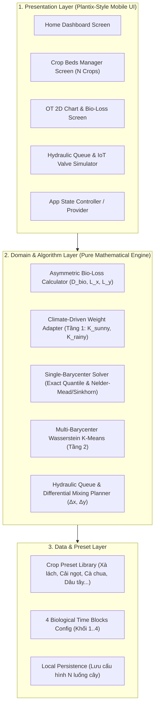

# 04. Kiến Trúc Kỹ Thuật & Lộ Trình Triển Khai (Technical Architecture & Implementation Roadmap)

## 1. Công nghệ & Kiến trúc Phần mềm Flutter (Clean Architecture 3 Lớp)

* **Framework đã chốt:** **Flutter (Dart)** – Đa nền tảng (Android, iOS, Web, Desktop).
* **Lưu trữ & Đồng bộ:** **Hybrid Offline-First Local Storage (`SharedPreferences` / Local JSON) + Cloud Database Sync (`Supabase` / `Firebase`)** kèm màn hình Đăng nhập tài khoản trang trại (hỗ trợ cả chế độ Demo nhanh không cần mạng).
* **Kiến trúc:** Tách biệt hoàn toàn giữa **Lõi Toán học Vận tải Tối ưu (`lib/domain/`)**, **Tầng Dữ liệu & Cloud Sync (`lib/data/`)** và **Giao diện Người dùng phong cách Plantix (`lib/presentation/`)**.



---

## 2. Cấu trúc Dữ liệu Cốt lõi (Core Data Contracts)

### 2.1. `CropBed` (Luống cây trồng thứ $i \in \{1..N\}$)
```json
{
  "id": "bed_117_1",
  "code": "117_1",
  "name": "Luống 1 - Rau Xà Lách",
  "cropType": "Xà lách thủy canh",
  "icon": "🥬",
  "growthStage": "Sinh trưởng lá",
  "targetPh": 5.8,
  "targetEc": 1.2,
  "sensitivityFactor": 2.0,
  "areaM2": 100
}
```

### 2.2. `TimeBlockConfig` (Cấu hình Khối giờ sinh học thứ $t \in \{1..4\}$)
```json
{
  "blockIndex": 2,
  "name": "Khối 2: Trưa nắng gắt",
  "timeRange": "10:00 - 14:00",
  "isActive": true,
  "alphaPh": 1.2,
  "baseWLow": 0.8,
  "extremeRatioK": 15.0,
  "baseWHigh": 12.0,
  "maxSpreadThresholdEc": 0.4,
  "maxBioLossThreshold": 1.5,
  "biologicalDescription": "Bức xạ cao, thoát hơi nước mạnh. Đẩy w_high lên mức cực đoan chống cháy rễ."
}
```

### 2.3. `OptimizationResult` (Kết quả Tính toán Độ đo Dinh dưỡng Tổng thể)
```json
{
  "timeBlock": 2,
  "weatherMode": "SUNNY_EXTREME",
  "effectiveWLow": 0.8,
  "effectiveWHigh": 24.0,
  "safetyQuantileTau": 0.032,
  "mode": "MULTI_BARYCENTER",
  "singleBarycenter": {
    "phStar": 6.1,
    "ecStar": 1.2,
    "totalBioLoss": 0.696
  },
  "euclideanMean": {
    "phMean": 6.1,
    "ecMean": 1.5,
    "totalBioLoss": 7.656,
    "burnedBedsCount": 1
  },
  "clusters": [
    {
      "clusterId": 1,
      "phStar": 5.8,
      "ecStar": 1.2,
      "bedIds": ["bed_117_1"],
      "clusterBioLoss": 0.0
    },
    {
      "clusterId": 2,
      "phStar": 6.4,
      "ecStar": 1.8,
      "bedIds": ["bed_117_2"],
      "clusterBioLoss": 0.0
    }
  ],
  "hydraulicSchedule": [
    {
      "period": 1,
      "clusterId": 1,
      "targetPh": 5.8,
      "targetEc": 1.2,
      "pipelineAction": "FRESH_MIX",
      "deltaPh": 5.8,
      "deltaEc": 1.2,
      "flushRequired": false
    },
    {
      "period": 2,
      "clusterId": 2,
      "targetPh": 6.4,
      "targetEc": 1.8,
      "pipelineAction": "DIFFERENTIAL_INJECTION",
      "deltaPh": 0.6,
      "deltaEc": 0.6,
      "flushRequired": false,
      "waterSavedPercent": 100
    }
  ]
}
```

---

## 3. Lộ trình Triển khai theo Lát cắt Dọc (Vertical Slice Roadmap)

Chúng ta sẽ triển khai ứng dụng theo 4 bước (Slices) rõ ràng, mỗi bước đều có thể kiểm thử ngay:

### Slice 1: Xây dựng & Kiểm thử Lõi Thuật toán (Core OT Algorithm & Unit Tests)
* Hiện thực hóa `BioLossCalculator`, `ClimateWeightAdapter`, `SingleBarycenterSolver`, `WassersteinKMeansSolver`, và `HydraulicScheduler`.
* Viết bộ kiểm thử tự động kiểm chứng Kịch bản 1 ($x^*=6.1, y^*=1.2$), Kịch bản 2 (2 cụm cuốn chiếu + bơm vi phân $\Delta x = +0.6, \Delta y = +0.6$), Kịch bản Ban đêm (Khối 4 ngắt hoàn toàn) và kịch bản $N$ loại cây bất kỳ.

### Slice 2: Khởi tạo Giao diện Mobile Phong cách Plantix & Quản lý $N$ Luống Cây
* Thiết lập khung Mobile App (Bottom Navigation 4 tab, Header trang trại, Theme màu Plantix High-Contrast).
* Xây dựng màn hình **Quản lý $N$ Luống Cây** với thư viện cây trồng có sẵn và nút nạp nhanh kịch bản mẫu.

### Slice 3: Trạm Điều Phối Chính (Home Dashboard) & Thẻ Chẩn Đoán An Toàn Rễ
* Xây dựng bộ chọn 4 Khối giờ sinh học ($t=1..4$) & 3 kịch bản Thời tiết.
* Hiển thị thẻ **Độ đo Dinh dưỡng Tổng thể $(x^*, y^*)$**, thẻ **Chẩn đoán Bác sĩ Cây trồng (Plantix Advisory)** và bảng đối chiếu trực tiếp với phương pháp Trung bình cộng.

### Slice 4: Biểu đồ Tọa độ 2D $(\text{pH}, \text{EC})$ & Mô phỏng Hàng đợi Thủy lực IoT
* Vẽ biểu đồ trực quan hóa $N$ luống cây, vị trí tâm $(x^*, y^*)$, các tâm cụm và mũi tên bơm bù vi phân.
* Xây dựng sơ đồ Bể phối trộn trung tâm (100), các van (107–113) và dòng thời gian phối trộn cuốn chiếu.

---

## 4. Tiêu chí Nghiệm thu Bản MVP (Definition of Done)

- [ ] Thuật toán tính toán đúng 100% các công thức trong tài liệu sáng chế cho cả Đơn tâm và Đa tâm động với số luống cây $N$ tùy ý.
- [ ] Khớp tuyệt đối số liệu ví dụ mẫu trong tài liệu ($N=2$: Xà lách & Cải ngọt ở Khối 1 và Khối 2).
- [ ] Giao diện chuẩn Mobile App hiện đại, dễ dùng theo phong cách Plantix, hỗ trợ thêm/sửa/xóa $N$ loại cây mượt mà.
- [ ] Có biểu đồ trực quan và sơ đồ mô phỏng đóng/mở van & tái sử dụng dung dịch nền đường ống.
